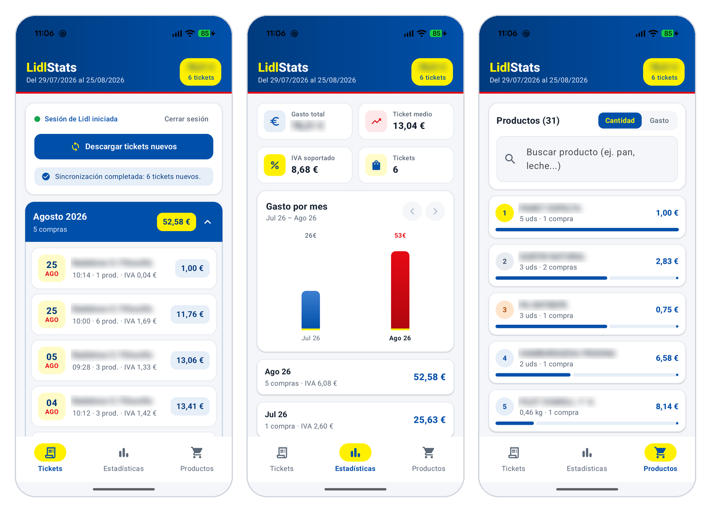

# LidlStats

## Español

App para Android (Jetpack Compose) que descarga los tickets de tus compras en tienda de tu cuenta de
**Lidl España** y muestra estadísticas de gasto. Todo se guarda en el móvil (SQLite); no se envía nada a
ningún sitio salvo a la propia web de lidl.es.

### Funciones
- **Tickets**: inicia sesión en lidl.es desde la app y descarga solo los tickets que aún no tienes. Se
  agrupan por meses desplegables y al pulsar uno se ve el ticket tal como lo imprime Lidl.
- **Estadísticas**: gasto total, ticket medio, número de tickets e IVA soportado, con una gráfica de barras de
  5 meses que se mueve con las flechas o deslizando el dedo para ver meses anteriores.
- **Productos**: buscador y orden por cantidad comprada o por gasto; para cada producto, el importe gastado,
  las unidades (o kg) compradas y el número de compras en que aparece.

### Cómo funciona
Tras iniciar sesión, la app reutiliza las cookies de sesión del WebView para llamar a la misma API JSON que
usa la página «Mis tickets» de lidl.es:
- `GET https://www.lidl.es/mre/api/v1/tickets?country=ES&page=N` → listado (id, fecha, total, tienda)
- `GET https://www.lidl.es/mre/api/v1/tickets/{id}?country=ES&languageCode=es-ES` → `ticket.htmlPrintedReceipt`

El ticket impreso es HTML cuyos `` llevan los datos en atributos (`data-art-description`,
`data-art-quantity`, `data-unit-price`, `data-tax-percentage`…). Ver
[`LidlReceiptParser`](app/src/main/java/io/github/neoruben/lidlstats/parser/LidlReceiptParser.kt).

## English

Android app (Jetpack Compose) that downloads your in-store receipts from your **Lidl Spain** account and
shows spending statistics. Everything is stored locally on the phone (SQLite); nothing is sent anywhere
except to lidl.es itself.

### Features
- **Tickets**: sign in to lidl.es from the app and download only the receipts you don't have yet. They are
  grouped by collapsible months; tap one to see the receipt as Lidl prints it.
- **Statistics**: total spent, average ticket, number of tickets and VAT paid, with a 5-month bar chart you
  can move with the arrows or by swiping to see earlier months.
- **Products**: search and sort by quantity bought or by money spent; for each product, the amount spent,
  the units (or kg) bought and the number of purchases it appears in.

### How it works
After signing in, the app reuses the WebView session cookies to call the same JSON API used by the lidl.es
"Mis tickets" page:
- `GET https://www.lidl.es/mre/api/v1/tickets?country=ES&page=N` → list (id, date, total, store)
- `GET https://www.lidl.es/mre/api/v1/tickets/{id}?country=ES&languageCode=es-ES` → `ticket.htmlPrintedReceipt`

The printed receipt is HTML whose `` elements carry the data in attributes (`data-art-description`,
`data-art-quantity`, `data-unit-price`, `data-tax-percentage`, …). See
[`LidlReceiptParser`](app/src/main/java/io/github/neoruben/lidlstats/parser/LidlReceiptParser.kt).
